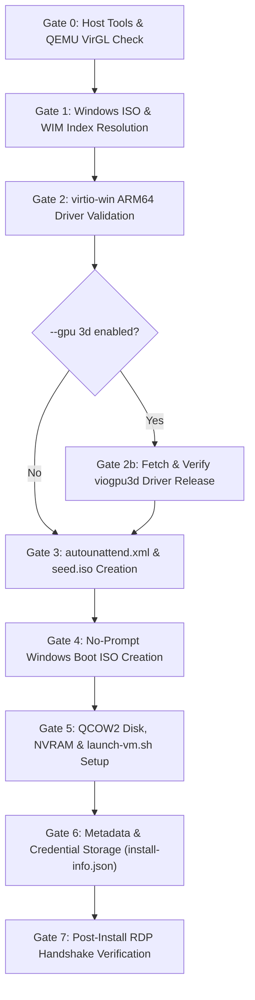
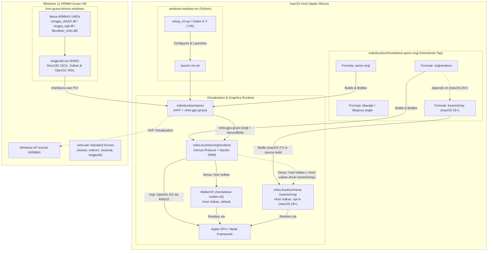

# windows-desktop-vm — Architecture & Development Guide

This document covers the internal architecture, gated provisioning pipeline,
timing data, coding standards, and build instructions for developers and
maintainers of `windows-desktop-vm`. End users should start with
[README.md](../README.md).

---

## Development Environment & Testing

### Host Requirements (macOS Apple Silicon)

The same host as for running a VM — see
[README: Requirements (host)](../README.md#requirements-host). `requirements.txt`
also pulls in pylint for the linter below.

### Running the Test Suite

Before making changes, verify that the existing unit tests pass:

```bash
python3 scripts/run-tests.py        # or: python3 -m unittest discover -s tests
```

The test suite covers:
- Answer file (`autounattend.xml`) template rendering and XML well-formedness
- Launcher script generation (`virtio-gpu-pci` for `--gpu 2d`, `virtio-gpu-gl-pci` + Venus for `--gpu 3d`)
- XML and shell escaping of user-supplied values
- WinPE driver set per `--gpu` mode and viogpu3d directory layouts
- viogpu3d package download, SHA-256 sidecar check and caching
- Windows ISO manifest (`manifest/windows.json`) handling
- WIM edition name → index resolution
- qemu-virgl resolution (opt prefix, PATH fallback only into a `qemu-virgl` keg, stock qemu rejected) and detection (`virtio-gpu-gl-pci` present)
- Install monitor phases and Gate 7 verification
- Host port probing and the RDP X.224 readiness probe
- QEMU Guest Agent (QGA) protocol client simulation

`verify_virtio_iso` (the Gate 2 ISO check) has no unit test.

### Code Style & Linters

Python source code is linted with pylint using the repository `.pylintrc`
(a relaxed rule set):

```bash
python3 scripts/lint-python.py                       # all tracked *.py, incl. scripts/
python3 scripts/lint-python.py --changed-since HEAD^ # only files changed since REF
```

Or invoke `pylint` directly using the repository configuration:

```bash
pylint --rcfile=.pylintrc $(git ls-files '*.py')
```

CI (`.github/workflows/pylint.yml`) lints changed files and runs the tests on
push, PR and manual dispatch.

---

## Architecture & Code Conventions

1. **Gated Orchestrator:**
   The provisioning pipeline is partitioned into ordered gates 0–7, plus 2b
   for `--gpu 3d` (`windows_vm/orchestrator.py`), each failing fast with a
   `GateError` — see [Gated provisioning pipeline](#gated-provisioning-pipeline).

2. **Template Isolation:**
   `launch-vm.sh` and `autounattend.xml` are rendered with Jinja2 via
   `windows_vm/templates.py`; the 3D `install.cmd` is written by
   `scripts/inject-drivers.sh`.
   Logic should live in Python helper functions rather than complex template tags.
   `autounattend.j2` is XML-autoescaped; in `launcher.j2` every interpolated
   value goes through the `sh` (bash word) and/or `qopt` (QEMU `,` → `,,`) filters.

3. **Two Display Paths:**
   `--gpu 2d` (default) uses `virtio-gpu-pci` with the Microsoft-signed
   `viogpudo` display-only driver from the virtio-win ISO. `--gpu 3d`
   (experimental) uses `virtio-gpu-gl-pci` with the alpha, test-signed
   `viogpu3d` driver. Gate 0 requires QEMU from the `milesbuckton/qemu-virgl`
   tap for both. See [GPU & display](#gpu--display).

---

## Gated provisioning pipeline

`windows_vm/orchestrator.py` runs gates 0–6 (plus 2b for `--gpu 3d`) as
preflight checks that catch environment, media, driver and hypervisor
defects before the VM starts; gate 7 launches the VM and verifies the
finished install. The structure mirrors the seven-gate Linux builder.



- **Gate 0 — Host environment (detect, don't install).** `xorriso`,
  `wimlib-imagex`, `hdiutil` and `swtpm` (skipped with `--no-tpm`) must be on
  `PATH`, else exit with brew hints. qemu-virgl is resolved to absolute
  paths — `/opt/homebrew/opt/qemu-virgl` first, else a `qemu-system-aarch64`
  on `PATH` that resolves into a `qemu-virgl` keg (`Cellar/qemu-virgl/...`);
  stock Homebrew QEMU is rejected. The gate confirms its
  `qemu-system-aarch64`, `qemu-img` and `edk2-aarch64-{code,vars}.fd` exist,
  and that `-device help` lists `virtio-gpu-gl-pci`. `qemu-img` and the
  rendered `launch-vm.sh` use these absolute paths.
- **Gate 1 — Windows media.** The ISO must be readable and is mounted
  read-only via `hdiutil`; `sources/install.wim` must be present
  (`install.esd` is rejected — convert it first). `wimlib-imagex info` reads
  the WIM in place and resolves `--edition` to its numeric index (exact name
  first, else an unambiguous substring), cached in `.cache/` by ISO
  path/size/mtime.
- **Gate 2 — virtio-win drivers.** Locates `virtio-win.iso` (`--virtio-iso`,
  then the target dir, then a copy from `~/Downloads`, else a download) and
  validates that it contains the ARM64 (`*/w11/ARM64`) storage (`viostor`),
  network (`NetKVM`), balloon (`Balloon`) and RNG (`viorng`) drivers, plus
  `viogpudo` for `--gpu 2d` only (omitted for 3D so Windows does not rank it
  above `viogpu3d`). A missing ARM64 qemu-ga installer is only a warning.
- **Gate 2b — 3D assets (`--gpu 3d` only).** Downloads
  `viogpu3d-arm64-win11.zip` from the Latest `kvm-guest-drivers-windows`
  release, validates it against the published SHA-256 sidecar (required only
  for the default URL) and extracts it to `<target>/viogpu3d` — or uses
  `--viogpu3d-url` / `--viogpu3d-sha256`, or a local tree via
  `--viogpu3d-drivers`.
- **Gate 3 — Answer file & seed.** Renders `templates/autounattend.j2` with the
  WIM index, product key and user credentials (disk partitioning is fixed in
  the template) and checks the result is well-formed with every component
  `processorArchitecture="arm64"`. `scripts/inject-drivers.sh` stages the
  drivers into `$WinPEDriver$` (with `--gpu 3d`, also `<seed>/viogpu3d` with a
  generated `install.cmd`); `scripts/make-seed-iso.sh` builds `seed.iso` with
  `hdiutil makehybrid` (volume label `UNATTEND`, `autounattend.xml` at the root).
- **Gate 4 — No-prompt ISO.** `media.make_noprompt_boot_iso` copies the
  Windows ISO to `<name>-noprompt.iso` (an APFS clone where possible) and
  writes `efisys_noprompt.bin` over its El Torito boot image (UDF untouched),
  so UEFI boots without waiting for "Press any key to boot from CD".
- **Gate 5 — VM hardware assembly.** Creates `disk.qcow2` with qemu-virgl's
  `qemu-img`, copies a fresh per-VM `edk2-aarch64-vars.fd`, and renders the
  executable bash launcher `launch-vm.sh` with the absolute qemu-virgl
  `qemu-system-aarch64` and firmware paths, checked with `bash -n`.
- **Gate 6 — Credential single source.** Writes `install-info.json` (VM name,
  user, RDP forward, marker and socket paths; no password, default
  permissions) and human-readable `install-info.txt`, which adds the password
  and is `chmod 600`.
- **Gate 7 — Unattended verification.** Launches `launch-vm.sh` in the
  background (output to `launch.log`; reuses a VM already running from the
  same directory) and waits up to 90 minutes for the guest's RDP service to
  answer an RDP handshake (QEMU's forward alone accepts TCP even with nothing
  listening), plus the marker file `C:\Windows\Setup\windows-vm-setup.log`
  whenever qemu-ga answers on `qga.sock`. virtio-win has no ARM64 qemu-ga, so
  without the agent RDP alone counts (it only turns on at first logon). Then
  writes `.install-complete`. Fails early if the VM exits.

---

## Timing

### Full build timings (latest all-3 fleet run)

Latest run: `scripts/build-fleet-sequential.py` with the default `CONFIGS`,
Apple Silicon MacBook Pro (Apple M5 Pro, host 18 cores / 48 GB; VM 4 vCPU /
8 GB), Windows 11 Pro ARM64 (`Windows11_Client_arm64_en-us_26300_9457.iso`)
and `virtio-win.iso` copied from `~/Downloads`, `viogpu3d` downloaded from the
Latest release for each 3D VM.

| VM | `setup_vm.py` (gates 0–7) | Shutdown | VM total | Result |
|---|---|---|---|---|
| windows-11-2d | 29m39s | 0m12s | 29m52s | VERIFY-OK, clean `system_powerdown` |
| windows-11-3d-moltenvk | 24m08s | 1m17s | 25m25s | VERIFY-OK, powered off on the 2nd `system_powerdown` |
| windows-11-3d-kosmickrisp | 16m31s | 0m20s | 16m51s | VERIFY-OK, clean `system_powerdown` |
| **Total** | — | — | **72m09s** | 3/3 OK (`== fleet summary (72m09s) ==`) |

Gates 0–6 take seconds; almost all of the `setup_vm.py` time is gate 7
(unattended Windows Setup, first logon and the RDP handshake), bounded at 90
minutes. Shutdown is bounded at 10 minutes (`SHUTDOWN_TIMEOUT`), with
`system_powerdown` re-sent every 60 s (`POWERDOWN_RESEND_INTERVAL`); the
MoltenVK VM ignored the first press, which is why its shutdown took 1m17s.

---

## GPU & display

User-facing setup, flags and limitations are in
[README: viogpu3d (experimental 3D)](../README.md#viogpu3d-experimental-3d);
the repositories in the stack are listed in [README: Components](../README.md#components).

### Component stack



### 3D graphics pipeline (`--gpu 3d`)

```
[Windows Guest Applications]
       │
       ▼
[Direct3D 10/11]              [Vulkan]                  [OpenGL (WGL)]
       │                          │                          │
       ▼                          ▼                          ▼
[viogpu_d3d10.dll         [libvulkan_virtio.dll      [viogpu_wgl.dll
 (Yttrium, Venus)]         (Venus)]                   (Gallium virgl)]
       │                          │                          │
       └────────────┬─────────────┘                          │
                    ▼                                        ▼
            [viogpu3d.sys Kernel Mode Driver: Venus and virgl contexts]
                    │
                    ▼ (virtio-gpu-gl-pci, blob resources)
            [QEMU + virglrenderer on Host]
                    │                                        │
                    ▼ Venus                                  ▼ virgl
     [Host Vulkan: MoltenVK or KosmicKrisp]    [Host OpenGL ES via ANGLE]
                    │                                        │
                    └───────────────────┬────────────────────┘
                                        ▼
                             [Apple Silicon Metal API]
```

Direct3D 10/11 (Mesa's Yttrium path) and Vulkan go through Venus to the
host's Vulkan driver (`--host-vulkan-driver`: MoltenVK by default or
KosmicKrisp; the build resolves its ICD and `launch-vm.sh` exports it, see the
README's viogpu3d host requirements); OpenGL (WGL) and GLES go through virgl (host OpenGL ES via
ANGLE). The user-mode drivers are ARM64X DLLs in `System32`, so x64 apps
running under emulation get the same acceleration as native ARM64 apps.
32-bit x86 apps are not covered.

### Guest test-signing flow

`viogpu3d` is test-signed, not Microsoft/WHQL-signed, so:

1. Secure Boot must stay off; the qemu-virgl tap's `edk2-aarch64` firmware
   does not enforce it.
2. `viogpu3d` must never be in `$WinPEDriver$` (Setup rejects test-signed
   drivers there); it installs only after OOBE, so Gate 3 stages it in
   `<seed>/viogpu3d` instead.
3. At first logon the answer file enables test signing
   (`bcdedit /set testsigning on`), turns hibernation off, copies
   `UNATTEND\viogpu3d` to `C:\viogpu3d`, schedules an on-start SYSTEM task
   running the generated `install.cmd`, and reboots.
4. On the next boot `install.cmd` trusts `VirtIOTestCert.cer` (Root +
   TrustedPublisher) and installs `viogpu3d.inf` with `pnputil`; the task
   then deletes itself. Logs: `C:\Windows\Setup\viogpu3d-firstlogon.log` and
   `viogpu3d-install.log`.

Hibernation (and with it Fast Startup) is turned off with
`powercfg /hibernate off` in every build, not only `--gpu 3d`. The manual
equivalent of this flow, and why Fast Startup must stay off, is in
[README: What it needs (guest)](../README.md#what-it-needs-guest).

---

## Audio

User-facing setup (qemu-virgl version, macOS microphone permission, RDP
redirection) is in [README: Audio & microphone](../README.md#audio--microphone).

`launch-vm.sh` (`templates/launcher.j2`) wires one CoreAudio audiodev to an
Intel HDA controller:

```
-audiodev coreaudio,id=snd0,timer-period=20000,out.buffer-length=23220,out.buffer-count=24,in.buffer-length=23220,in.buffer-count=24
-device intel-hda
-device hda-micro,audiodev=snd0
```

* **Codec choice.** Windows' inbox HD Audio driver has no virtio-snd
  counterpart, so HDA it is. `hda-micro` exposes a line-out plus a pin the
  inbox driver enumerates as a **Microphone**; `hda-duplex` would show its
  input as "Line In" and `hda-output` (used before capture existed) has no
  input at all.
* **Capture backend.** CoreAudio capture is a
  [milesbuckton/qemu](https://gitlab.com/milesbuckton/qemu) fork feature
  (November 2026): it records from the macOS default input device, takes
  the `in.*` audiodev options, and maps a mono microphone to the codec's stereo
  input. Older qemu-virgl builds have no CoreAudio capture: the guest still
  sees the microphone but records silence.
* **Buffering.** The `in.*` values mirror `out.*` (24 × 23220 µs buffers,
  20 ms timer) so both directions tolerate the same scheduling jitter.

---

## Building ARM64 viogpu3d Driver from Source

The [kvm-guest-drivers-windows](https://github.com/milesbuckton/kvm-guest-drivers-windows)
fork builds and publishes this package automatically
(`.github/workflows/build-arm64.yml` on branch `master`). Pull requests only
build it; a manual run of the workflow (`workflow_dispatch`) on `master`
publishes a test-signed `viogpu3d-arm64-win11.zip` + `.sha256` in a release
marked Latest, which `setup_vm.py --gpu 3d` downloads by default. That
workflow is the reference for the steps below (it builds Mesa with MSVC
`x64_arm64`, builds the Venus Vulkan driver with `/experimental:c11atomics`,
disables Mesa's d3d10 test, and adds the ARM64X user-mode drivers). Build by
hand only if you need to change the driver or Mesa.

### Prerequisites (Windows build host or VM)

1. **Visual Studio 2022 (or Build Tools)** with the C++ ARM64 build tools, plus the
   **Windows Driver Kit** (CI uses the runner's preinstalled WDK and runs
   `choco install windowsdriverkit10` only if none is found). The 24H2 EWDK also works.
2. **Python 3** with `pip install meson ninja mako pyyaml packaging` (CI: Python 3.11,
   `meson==1.9.1 ninja==1.13.0 mako==1.3.10 pyyaml==6.0.3 packaging==25.0`).
3. **win_flex / win_bison** (`choco install winflexbison3`).
4. Clones of:
   - Kernel driver: [milesbuckton/kvm-guest-drivers-windows](https://github.com/milesbuckton/kvm-guest-drivers-windows) (branch `master`)
   - Mesa user-mode driver: [miles.buckton/mesa](https://gitlab.freedesktop.org/miles.buckton/mesa) at the commit pinned as `DEFAULT_MESA_REF` in the workflow (the workflow also applies `.github/patches/mesa-*.patch`)

### Step 1: Build the Mesa ARM64 user-mode drivers

From a PowerShell with the MSVC **x64_arm64** environment loaded (the
`d3d10umddi.h` / `d3dkmddi.h` WDK headers must be on `INCLUDE`), in the
Mesa checkout. `cross_arm64.txt` is the Meson cross file from the
workflow (`cl`/`lib`/`rc`, `cpu_family = 'aarch64'`, `system = 'windows'`):

```powershell
$env:MESA_PREFIX_ARM64 = "$PWD\..\mesa_prefix_arm64"

meson setup build-arm64 `
  --cross-file cross_arm64.txt `
  --prefix $env:MESA_PREFIX_ARM64 `
  -Dbuildtype=release -Db_ndebug=true -Dbuild-tests=false `
  -Dc_args="/wd4189 /experimental:c11atomics" -Dcpp_args="/wd4189" `
  -Dgallium-drivers=virgl -Dgallium-d3d10umd=true -Dgallium-yttrium=true `
  -Dgallium-wgl-dll-name=viogpu_wgl -Dgallium-d3d10-dll-name=viogpu_d3d10 `
  -Dvulkan-drivers=virtio `
  -Dzlib=disabled -Dc_std=c11 -Db_vscrt=mt

ninja -C build-arm64 install
```

Also disable the `d3d10` test in `src/gallium/targets/d3d10umd/meson.build`
(it does not build for ARM64). Mesa installs the Venus driver as
`vulkan_virtio.dll`; copy it to `libvulkan_virtio.dll`, and write
`share\vulkan\icd.d\virtio_icd.aarch64.json` into the prefix if Mesa did not —
the driver project requires both to exist. `$env:MESA_PREFIX_ARM64\bin` must end up with
`viogpu_d3d10.dll`, `viogpu_wgl.dll`, `libvulkan_virtio.dll`, `libEGL.dll`,
`libGLESv1_CM.dll`, `libGLESv2.dll` and `opengl32.dll`.

### Step 1b (optional): ARM64X user-mode drivers

A plain ARM64 user-mode driver only serves native ARM64 apps; x64 apps
running under emulation cannot load it. To cover them, build Mesa a second
time for arm64ec and combine both builds into ARM64X front DLLs with
`viogpu\viogpu3d\tools\arm64x\make_arm64x.ps1`, then pass the output
directory as `/p:MESA_ARM64X_DIR=...` in step 2. The "Configure and build
Mesa (ARM64EC)" and "Assemble ARM64X user-mode drivers" workflow steps and
`viogpu/viogpu3d/BUILDING.md` have the details. Without it the package is
native ARM64 only.

### Step 2: Build the viogpu3d kernel-mode driver (KMD)

From the same environment, in the `kvm-guest-drivers-windows` checkout:

```powershell
cd viogpu
msbuild viogpu3d.sln /t:Build /p:Configuration="Win11 Release" `
  /p:Platform=ARM64 /p:MESA_PREFIX_ARM64="$env:MESA_PREFIX_ARM64"
```

The packaged driver tree lands in `viogpu\Install\Win11\ARM64`
(`viogpu3d.inf`, `viogpu3d.sys`, `viogpu3d.cat`, `vgpusrv.exe`, `viogpuap.exe`,
with the `*_arm64.dll` Mesa binaries, plus the `*_arm64x.dll` / `*_arm64ec.dll`
pairs when `MESA_ARM64X_DIR` is set, in an `arm64\` subfolder). Test-sign `viogpu3d.sys` and
`viogpu3d.cat` with `build\VirtIOTestCert.pfx`
(`signtool sign /fd SHA256 /f build\VirtIOTestCert.pfx <file>`) and copy
`build\VirtIOTestCert.cer` alongside — the guest needs it to trust the driver.

### Step 3: Supplying the Driver to windows-desktop-vm

Transfer the output folder to your macOS host and pass it during VM generation
(`--viogpu3d-drivers` is ignored without `--gpu 3d`):

```bash
python3 setup_vm.py --gpu 3d \
  --viogpu3d-drivers /path/to/extracted/Install/Win11/ARM64 \
  --iso ~/Downloads/Win11_24H2_English_Arm64.iso \
  --target-dir ~/VMs/windows-11
```
